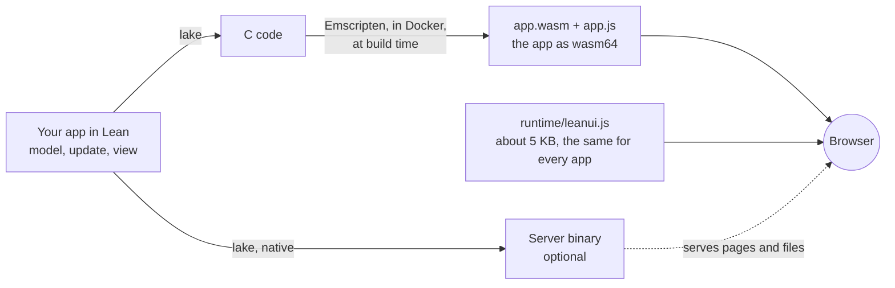
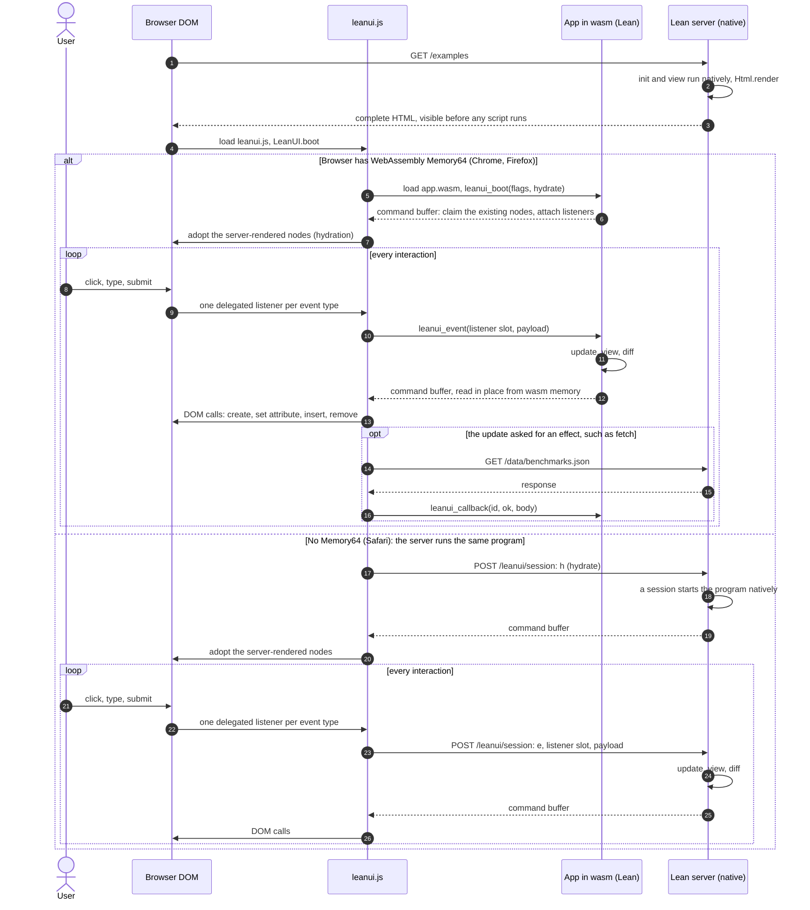

# LeanUI

**Web user interfaces written in Lean 4.** An app is a pure Elm-architecture program (a model, an
`update` function and a `view`) whose views are ordinary Lean values, or JSX-style templates that
compile to the same code. It runs in the browser as **single-threaded wasm64**, drives the DOM
through a compact binary command buffer, and the same program renders on a native Lean server,
which can also drive the page remotely for browsers without WebAssembly Memory64.

```lean
module
public import LeanUI
meta import LeanUI.Syntax          -- templates are compile-time only: zero runtime cost
public section
open LeanUI

inductive Msg | inc | dec

def view (n : Int) : Html Msg :=
  <p>
    <button onClick={.dec}>−</button>
    <output class={if n < 0 then "neg" else "pos"}>{n}</output>
    <button onClick={.inc}>+</button>
  </p>

def program : Program Int Msg where
  init _ := (0, .none)
  update msg n := (match msg with | .inc => n + 1 | .dec => n - 1, .none)
  view := view
```

## What is in the box

| | |
|---|---|
| **Core** (`LeanUI.Html`, `Diff`, `Patch`, `App`, `Effect`) | views, keyed and positional reconciliation, exact `lazy`/`memo` subtrees, delegated events with browser-extracted payloads, commands (fetch, timers, storage, history, focus, title, animation frames) and subscriptions, all as commands in one buffer per update |
| **Templates** (`LeanUI.Syntax`, [docs/SYNTAX.md](docs/SYNTAX.md)) | JSX-style syntax with components, fragments, conditional children, class/style parts, SVG and MathML namespaces, precise compile errors; the generated C equals the hand-written view's |
| **Kit** (`LeanUI.Json`, `LeanUI.Router`) | JSON on `Init` alone with exact numbers and `deriving ToJson, FromJson`; typed bidirectional routes (path or fragment) whose links cannot drift from the parser |
| **Server** (`LeanUI.Server`) | a native `Std.Http` server: static files, server-side rendering with hydration, server-driven sessions, the `leanui` command (`serve`, `build`, `new`) |
| **Proofs** ([docs/PROOFS.md](docs/PROOFS.md)) | the keyed reconciliation planner is machine-checked correct and optimal (fewest moves); TodoMVC's model keeps its list keys unique under every message |
| **Testing** (`LeanUI.Testing`) | a pure DOM model that applies command buffers exactly as the browser does, property tests and fuzzing against a reference model, a strict protocol checker, SSR parser checks, browser suites in Chromium and Firefox |
| **Examples** | a counter, [TodoMVC](examples/TodoMVC.lean) (the full spec, proved invariants), [the LeanUI site](examples/Site.lean) (routed pages, components, fetch, SVG; server-rendered), the js-framework-benchmark app, an effects lab, [the guide's notes app](docs/GUIDE.md) |

## How it works

An app is built twice from the same Lean code. Emscripten is used only at build time: the
browser receives its output, never the compiler.



At run time, Lean does all the computing and a small fixed JavaScript runtime makes the DOM
calls, because WebAssembly cannot reach the DOM directly. One page, from the first request to
the user's clicks:



The server is optional. Served by any static file host (`leanui serve`), a page starts empty
and the wasm mounts the app, with every interaction as in the first branch above.

## How it performs

The [js-framework-benchmark](https://github.com/krausest/js-framework-benchmark) keyed operations,
against a hand-written vanilla JavaScript implementation with the same markup, stylesheet and data
(both build identical tables). CPU time per operation, LeanUI ÷ vanilla: Chromium traced (script
plus the rendering work it causes), release Chrome and Firefox self-timed (script plus layout),
on an Apple M4 Max; [docs/BENCHMARKS.md](docs/BENCHMARKS.md) has the method, every number,
memory, startup and the profiles.

| operation | Chromium 151 (script + render) | Chrome 155 (script + layout) | Firefox 158 (script + layout) |
|---|--:|--:|--:|
| create 1,000 rows | 1.27× | 1.28× | 1.54× |
| replace all 1,000 rows | 1.42× | 1.47× | 1.89× |
| update every 10th of 1,000 rows | 1.21× | 1.30× | 1.75× |
| highlight a row (of 1,000) | 1.46× | 8.00× | 3.00× |
| swap 2 of 1,000 rows | 1.17× | 1.35× | 1.30× |
| remove one of 1,000 rows | 1.11× | 1.30× | 1.11× |
| create 10,000 rows | 1.45× | 1.31× | 1.52× |
| append 1,000 rows to 1,000 | 1.34× | 1.34× | 1.81× |
| clear 1,000 rows | 1.65× | 1.72× | 1.53× |
| **geometric mean** | **1.33×** | **1.68×** | **1.66×** |

Chrome's `performance.now()` has 0.1 ms steps on pages without cross-origin isolation, so its
"highlight a row" cell (LeanUI 0.8 ms, vanilla rounding to 0.1 ms) mostly measures resolution;
without it Chrome's mean is 1.38×, and the traced Chromium column (microsecond timestamps)
gives 1.46× for that operation.

Natively, Lean selects a row in 0.12 ms (update, view, diff and encoding) and re-renders 1,000
unchanged rows in 0.06 ms. The benchmark app is ready about 25 ms after navigation in Chromium
and weighs 155 KB with brotli (wasm, glue and runtime).

## Writing apps

A few idioms cover most of what an app needs; `examples/` has each of them in a real program.

- **Effects** are values: `update` returns a `Cmd` (`.fetch`, `.after`, `.storageSet`,
  `.storageGet`, `.pushUrl`, `.focus`, `.title`, …) whose results come back as messages, and
  `subscriptions` returns the event sources wanted right now (`.every ms`, `.urlChanges`). In a
  module that does `open LeanUI`, write the subscription type as `LeanUI.Sub` (Lean's own `Sub`
  is the subtraction class).
- **Big lists**: give rows keys and make them lazy, so unchanged rows are neither rendered nor
  diffed: `keyedLazy (toString r.id) (r.label, selected) fun _ => row r`. Dependencies are
  compared exactly (any `ToDep` value: numbers, strings, booleans, options, tuples, lists), and
  so is the key, which therefore need not be repeated among them.
- **Components** are programs: embed one with `Html.map`, `Cmd.map` and `Sub.map`
  (`examples/Site.lean` embeds the counter and TodoMVC this way).
- **Routing**: `LeanUI.Router` routes are bidirectional, so a link and the parser cannot drift
  apart; `router.link page attrs kids` navigates without a page load.
- **JSON**: `deriving ToJson, FromJson` (with `meta import LeanUI.Json.Derive`), then
  `Json.encode` / `Json.decode`.
- **Server rendering**: `LeanUI.Server` renders any page of a program to HTML and lets the wasm
  build hydrate it, or drives it from the server (`docs/SERVER.md`).

## The LeanUI site

`examples/Site.lean` is a real multi-page app: a home page with a live counter, the examples
(the counter and TodoMVC as embedded components) and the benchmark results (fetched as JSON and
drawn as SVG). A native Lean server renders each page, then the wasm build hydrates it, or, in a
browser without Memory64, the server runs the program and drives the page.

```bash
tools/build-app.sh SiteApp site
./.lake/build/bin/leanui-site               # http://127.0.0.1:5360/  (?mode=wasm|server|ssr)
```

## Browsers

LeanUI's wasm needs WebAssembly **Memory64** and exception handling: Chrome and Edge 133+, Firefox
134+. Pages need no special headers (the runtime is built without threads, so no
`SharedArrayBuffer` and no cross-origin isolation). Safari has no Memory64 yet: there the server
runs the same program natively and drives the page over HTTP (`LeanUI.boot` picks the mode).

## Building

Requirements: the Lean toolchain named in `lean-toolchain` (v4.34.0) and Docker.

```bash
toolchain/build-archives.sh                 # once: the single-threaded wasm64 Lean runtime (≈10 min)
~/.elan/toolchains/leanprover--lean4---v4.34.0/bin/lake build   # library, examples, tests, proofs
tools/build-app.sh TodoMVCApp todomvc       # an app: dist/todomvc/{index.html,leanui.js,app.js,app.wasm}
./.lake/build/bin/leanui serve dist/todomvc # and open http://127.0.0.1:8000/
```

[docs/TOOLCHAIN.md](docs/TOOLCHAIN.md) explains what is linked and why it is single-threaded.

## Testing

```bash
./.lake/build/bin/leanui-tests            # core: diff, keyed/positional/lazy lists, render, planner
./.lake/build/bin/leanui-props            # property tests and fuzzing against the reference model
./.lake/build/bin/leanui-syntax-tests     # templates
./.lake/build/bin/leanui-kit-tests        # JSON, URLs, routes, effects
./.lake/build/bin/leanui-server-tests     # server, sessions, CLI
./.lake/build/bin/leanui-todomvc-tests    # TodoMVC against the DOM model
node tests/browser/todomvc.mjs            # real browsers (Playwright); also site, counter, effects,
                                          # keyed-dom, fuzz, depth, server, apply-semantics
node tests/browser/bench.mjs              # the benchmark (Chromium traces); selfbench.mjs for release browsers,
                                          # apply-bench.mjs for the JS runtime alone
```

`lake build` also checks every proof.

## Documentation

- [docs/DESIGN.md](docs/DESIGN.md): the architecture and the contracts between its parts
- [docs/PROTOCOL.md](docs/PROTOCOL.md): the command-buffer protocol, normatively
- [docs/SYNTAX.md](docs/SYNTAX.md): templates
- [docs/PROOFS.md](docs/PROOFS.md): what is proved, tested and assumed
- [docs/BENCHMARKS.md](docs/BENCHMARKS.md): performance, memory, startup, method
- [docs/SERVER.md](docs/SERVER.md): the native server, server rendering, server-driven sessions
- [docs/TOOLCHAIN.md](docs/TOOLCHAIN.md): the wasm64 toolchain

## License

MIT, see [LICENSE](LICENSE).
